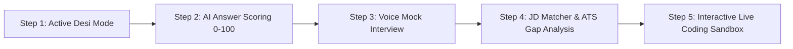

# 🚀 Unique Feature Blueprints & Master Prompts for ChatGPT / Codex

This document provides complete architectural specifications, data flows, and **copy-paste ready master prompts** designed to instruct **ChatGPT / OpenAI Codex** to generate production-ready code for the **AI Interview Assistant** project.

---

## 📑 Table of Contents
1. [Feature 1: Voice Mock Interview Mode with Real-Time Speech Analytics](#feature-1-voice-mock-interview-mode)
2. [Feature 2: AI Answer Evaluation & STAR Scoring Rubric (0-100 Scorecard)](#feature-2-ai-answer-evaluation--star-scoring-rubric)
3. [Feature 3: Active "Desi Mode" & Persona Tone Switcher](#feature-3-active-desi-mode--persona-tone-switcher)
4. [Feature 4: Job Description (JD) Matcher & ATS Skills Gap Analyzer](#feature-4-job-description-jd-matcher--ats-skills-gap-analyzer)
5. [Feature 5: Interactive In-Browser Live Coding & Whiteboard Round](#feature-5-interactive-in-browser-live-coding--whiteboard-round)

---

<a name="feature-1-voice-mock-interview-mode"></a>
## 🎙️ Feature 1: Voice Mock Interview Mode with Real-Time Speech Analytics

### 🧠 The Concept & Why It's Unique
Most interview preparation tools are text-only. In reality, technical and behavioral interviews are verbal under high cognitive load. Candidates stumble not because of technical ignorance, but because of delivery issues: speaking too fast, freezing, or overusing filler words (*"um", "like", "basically", "actually"*).

### 🛠️ Architecture & Flow
1. **AI Question Speech (Text-to-Speech):** When the candidate clicks **"Start Voice Round"**, the browser uses the native `window.speechSynthesis` API (free, zero external latency) to speak the interview question in a natural interviewer cadence.
2. **Audio Speech-to-Text (STT):** Candidate presses the microphone button. The browser utilizes native `webkitSpeechRecognition` / `SpeechRecognition` to stream live transcription into the text area.
3. **Real-time Analytics:**
   - **Filler Word Counter:** Client-side regex scanner tracking occurrences of: `um`, `uh`, `like`, `you know`, `actually`, `basically`, `sort of`.
   - **Pacing / Speedometer:** Computes Words Per Minute (WPM) during the recording window (Flagging: <110 WPM = *Slow/Hesitant*, 120–160 WPM = *Ideal*, >170 WPM = *Rushed*).
4. **Submission:** Sends the transcribed response to `/ai/evaluate-answer` alongside verbal delivery metrics.

---

### 📋 Master Prompt for ChatGPT / Codex

```markdown
### TASK: Implement Voice Mock Interview Mode with Speech-to-Text and Delivery Analytics

You are an expert full-stack developer working on an AI Interview Assistant project.
- Backend: FastAPI (Python 3.10+) in `app/`
- Frontend: React 18 + TypeScript + Vite + Tailwind CSS + Framer Motion in `frontend/`

#### Objective:
Build a complete Voice Mock Interview interface that allows candidates to practice answering interview questions verbally, hear the AI speak the question aloud, capture their speech in real-time, and analyze their speaking pace (WPM) and filler words.

#### Step 1: Frontend Voice Component (`frontend/src/components/VoiceInterviewModal.tsx`)
Create a modal component that:
1. Receives `questionText: string` and `onComplete: (transcript: string, metrics: SpeechMetrics) => void`.
2. Has a "Play Question Audio" button that uses `window.speechSynthesis` with `SpeechSynthesisUtterance` to read the question aloud with pause/resume capabilities.
3. Implements browser Speech-to-Text using `webkitSpeechRecognition` or `SpeechRecognition`:
   - Start/Stop recording toggle button with an animated pulse wave ring when recording.
   - Real-time live transcript display inside a styled dark-mode card.
4. Computes live speech delivery metrics:
   - Filler word counter tracking: "um", "uh", "like", "actually", "basically", "you know", "kind of".
   - Speaking Pace (Words Per Minute): Computes `(wordCount / elapsedMinutes)` and labels it:
     - < 110 WPM: "Pace: Slow / Deliberate"
     - 110 - 165 WPM: "Pace: Optimal & Confident"
     - > 165 WPM: "Pace: Fast / Rushed"
5. Provides a "Submit Verbal Answer" button that passes the final transcribed text and metric summary to the parent handler.
6. Handles browser compatibility gracefully (if Web Speech API is not supported in the browser, show a fallback notice).

#### Step 2: Dashboard Integration (`frontend/src/pages/Dashboard.tsx`)
1. Add a "Practice Verbally 🎙️" button beside each generated technical question in the questions list.
2. Opening the button launches the `VoiceInterviewModal`.
3. Upon completion, automatically transfer the transcribed text into the answer evaluation box or AI Coach.

Ensure all styles match Tailwind dark mode with glassmorphic styles (`bg-dark-900`, `border-white/10`, `text-white`). Provide complete, fully typed TypeScript code without placeholders.
```

---

<a name="feature-2-ai-answer-evaluation--star-scoring-rubric"></a>
## 📊 Feature 2: AI Answer Evaluation & STAR Scoring Rubric (0-100 Scorecard)

### 🧠 The Concept & Why It's Unique
Current chatbots simply give a block of text response like *"That's a good answer, but..."*. Candidates need actionable, quantitative metrics similar to how hiring committees at FAANG/Tier-1 companies evaluate technical depth and the STAR framework (Situation, Task, Action, Result).

### 🛠️ Architecture & Flow
1. **Input:** Candidate selects any interview question and types or dictates their answer.
2. **Backend API (`POST /ai/evaluate-answer`):**
   - Inputs: `question: str`, `candidate_answer: str`, `tech_stack: Optional[str]`.
   - Prompt Engine: Forces the LLM to output a strict JSON structure containing scores for 4 categories (25 points each):
     - `technical_depth` (0-25)
     - `star_structure` (0-25)
     - `clarity_communication` (0-25)
     - `tradeoffs_and_edge_cases` (0-25)
   - Outputs: `total_score` (0-100), `strengths: list[str]`, `areas_for_improvement: list[str]`, and `ideal_model_answer: str`.
3. **Frontend Scorecard UI:** Circular progress ring for overall score, color-coded metric breakdown bars, and a tab to view the side-by-side comparison between their answer and the AI's model answer.

---

### 📋 Master Prompt for ChatGPT / Codex

```markdown
### TASK: Implement AI Answer Evaluation & STAR Scoring Rubric (0-100 Scorecard)

You are an expert full-stack engineer. Implement an automated interview answer grading rubric with a 0-100 evaluation engine.

#### Project Context:
- FastAPI backend in `app/`
- React + Vite + TypeScript frontend in `frontend/`

#### Step 1: Backend Pydantic Schemas (`app/models/schemas.py`)
Define:
```python
class AnswerEvaluationRequest(BaseModel):
    question: str
    user_answer: str
    skills: list[str] = []

class ScoreBreakdown(BaseModel):
    technical_depth: int          # 0-25
    star_structure: int           # 0-25
    clarity_communication: int    # 0-25
    tradeoffs_and_edge_cases: int # 0-25

class AnswerEvaluationResponse(BaseModel):
    overall_score: int            # 0-100
    grade_label: str              # e.g., "Strong Hire", "Leaning Hire", "Needs Work"
    breakdown: ScoreBreakdown
    strengths: list[str]
    improvements: list[str]
    ideal_model_answer: str
```

#### Step 2: Backend Endpoint (`app/api/v1/endpoints/ai.py`)
Create `POST /ai/evaluate-answer`:
1. Constructs a strict JSON prompt instructing the LLM (Gemini or fallback) to evaluate the candidate's answer against the 4 dimensions.
2. If the LLM throws an error or is offline, implement a reliable heuristic evaluation fallback that analyzes answer length, presence of STAR keywords ("situation", "result", "implemented", "scaled"), and technical keywords from the skill list to return a realistic score.
3. Validates and returns `AnswerEvaluationResponse`.

#### Step 3: Frontend Component (`frontend/src/components/AnswerEvaluator.tsx`)
Create an evaluation interface:
1. Rich textarea for candidate to write their answer (with character/word count).
2. "Evaluate My Answer" button with animated loading state.
3. Once submitted, display an interactive Scorecard:
   - Overall Score with radial badge:
     - 85-100: Green (Strong Hire)
     - 70-84: Blue (Hire)
     - 50-69: Amber (Borderline)
     - < 50: Red (Needs Improvement)
   - 4 Category Progress Bars with micro-animations.
   - Bulleted "Strengths" (green checkmarks) and "Key Improvements" (amber caution icons).
   - "View Ideal Model Answer" expandable accordion with a copy-to-clipboard button.

Provide full, clean, working code for both backend and frontend.
```

---

<a name="feature-3-active-desi-mode--persona-tone-switcher"></a>
## 🇮🇳 Feature 3: Active "Desi Mode" & Persona Tone Switcher

### 🧠 The Concept & Why It's Unique
While the landing page showcases "Desi Mode" (vernacular, relatable Hindi/Hinglish analogies like autorickshaw/waiter analogies for APIs), the actual AI chat currently runs on a generic system prompt. Making this functional allows users to switch between three distinct personas depending on their learning mood and confidence level.

### 🛠️ Architecture & Flow
1. **Persona Selection in UI:** Segmented switcher at the top of the chat panel:
   - 👔 **Strict FAANG Interviewer:** Direct, pushes for edge cases, asks concise follow-ups (*"What happens when concurrent writes exceed 10k/sec? What are the CAP theorem trade-offs?"*).
   - 🇮🇳 **Desi Mentor (Hinglish/Analogy):** Welcoming, breaks down technical jargon using everyday analogies (*"Bhai, simple bhasha mein samjho... API ek restaurant ke waiter jaisa hota hai..."*), supportive.
   - 🎓 **Standard Senior Architect:** Balanced, structured, uses code snippets, STAR framework.
2. **Backend Payload:** Update `ChatRequest` in `schemas.py` to accept `mode: Literal["desi", "strict", "standard"] = "standard"`.
3. **Dynamic Prompt Injection:** `InterviewService` constructs the system prompt dynamically based on the selected mode.

---

### 📋 Master Prompt for ChatGPT / Codex

```markdown
### TASK: Implement Active "Desi Mode" & Multi-Persona Tone Switcher in AI Chat

You are an expert engineer. Connect the landing page's "Desi Mode" concept directly into the live AI Chat system so candidates can switch between interview coaching personas on the fly.

#### Step 1: Update Backend Schema (`app/models/schemas.py`)
Modify `ChatRequest`:
```python
class ChatRequest(BaseModel):
    message: str
    persona: str = "standard"  # Options: "standard", "desi", "strict"
    resume_context: str | None = None
```

#### Step 2: Persona-Driven AI Prompting (`app/services/ai_service.py` & `app/api/v1/endpoints/ai.py`)
Update the chat handler to inject customized system prompts based on `persona`:
- `desi`:
  "You are an experienced, friendly Indian Tech Lead / Mentor (Desi Mode). Explain complex computer science and system design concepts using intuitive real-world analogies (e.g., IRCTC booking queues, UPI transactions, restaurant waiters, local traffic). Use a warm, natural Hinglish-conversational tone (mix of accessible English with common friendly terms like 'Dost', 'dekho', 'socho'). Focus on clarity, intuition, and interview confidence."
- `strict`:
  "You are a demanding, no-nonsense FAANG Principal Bar-Raiser interviewer. Be terse, analytical, and highly critical. Challenge candidate assumptions, probe scalability bottlenecks, ask for time/space complexity, and demand concrete metrics and edge-case handling. Do not flatter; provide rigorous, blunt feedback."
- `standard`:
  "You are a professional, supportive AI Technical Interview Coach. Provide structured explanations with code snippets, architectural trade-offs, and STAR methodology tips."

Ensure Redis caching key builder in `ai.py` includes `persona` in the hash key so different modes do not collide in cache.

#### Step 3: Frontend Chat UI Update (`frontend/src/components/AIChat.tsx`)
1. Add a persona switcher toolbar in the header of `AIChat.tsx`:
   - 3 segmented buttons: `👔 Strict FAANG`, `💡 Standard Coach`, `🇮🇳 Desi Mentor`.
   - Highlight the active persona with smooth background pill animation.
2. Include a tooltip explaining what each persona does.
3. Pass `persona` in the API payload to `POST /ai/chat`.
4. Provide appropriate default starter greetings when the user switches persona.

Provide complete, copy-paste ready code for both Python and React.
```

---

<a name="feature-4-job-description-jd-matcher--ats-skills-gap-analyzer"></a>
## 🎯 Feature 4: Job Description (JD) Matcher & ATS Skills Gap Analyzer

### 🧠 The Concept & Why It's Unique
Candidates rarely interview in a vacuum; they interview for a **specific job posting** (e.g., *"Senior Backend Engineer at Uber"*). Currently, the platform only looks at their resume. By accepting a target Job Description (JD), the platform can calculate the **ATS Match Compatibility %**, pinpoint **missing skills**, and generate questions designed specifically to test the candidate on the gap between their resume and the job requirements!

### 🛠️ Architecture & Flow
1. **Frontend Input:** An "Analyze Target Job Posting" tab/modal where candidates paste the text of a job posting.
2. **Backend Engine (`POST /resume/match-jd`):**
   - Extracts required skills & qualifications from the Job Description.
   - Compares them against candidate skills parsed from their uploaded resume.
   - Calculates:
     - `match_score_percentage` (0–100%)
     - `matched_skills: list[str]` (Skills present on both)
     - `missing_critical_skills: list[str]` (Skills in JD missing from resume)
     - `targeted_gap_questions: list[str]` (5 challenging questions specifically targeting the missing skills so the candidate can prepare for curveballs).
3. **Database:** Stores match results linked to the candidate's resume session.

---

### 📋 Master Prompt for ChatGPT / Codex

```markdown
### TASK: Implement Job Description (JD) Matcher & ATS Skills Gap Analyzer

You are an expert full-stack engineer. Build a feature that compares a candidate's uploaded resume with a target Job Description (JD) to compute compatibility and generate targeted gap questions.

#### Project Architecture:
- FastAPI backend in `app/`
- SQLAlchemy with Neon PostgreSQL / SQLite in `app/db/`
- React + TypeScript frontend in `frontend/`

#### Step 1: Backend Endpoint (`app/api/v1/endpoints/resume.py`)
1. Create request schema:
```python
class JDMatchRequest(BaseModel):
    resume_id: int
    job_description: str
```
2. Implement route `POST /resume/match-jd`:
   - Fetch the candidate's resume text and extracted skills from DB using `resume_id`.
   - Prompt the LLM (or execute keyword extraction fallback) to:
     a) Extract required tech stack, libraries, and architectural skills from `job_description`.
     b) Compute `match_percentage` based on overlap and seniority alignment.
     c) Categorize skills into `matched_skills` and `missing_skills`.
     d) Generate 5 `targeted_gap_questions` designed to test how the candidate would handle the technologies they appear to lack on paper.
   - Return response JSON:
     `{"match_score": int, "matched_skills": list[str], "missing_skills": list[str], "gap_questions": list[str]}`

#### Step 2: Frontend JD Matcher Component (`frontend/src/components/JDMatcherModal.tsx`)
1. Build a clean modal or dashboard view:
   - Textarea to paste Job Description with quick example buttons ("Paste Frontend Role", "Paste Backend Role").
   - "Analyze Match & Predict Interview Questions" button.
2. Results Screen:
   - Visual Match Gauge (e.g. "82% Match - High Compatibility").
   - Two-column skill chip matrix:
     - Green Chips: Matched Competencies (e.g., Python, React, PostgreSQL).
     - Amber Chips: Missing Skill Gaps (e.g., Redis, Kubernetes, Kafka).
   - "Recommended Gap Prep Questions": A list of generated questions addressing those specific missing areas with a button to immediately add them to the candidate's active interview practice list.

Ensure the code is robust, type-safe, and styled with Tailwind dark theme.
```

---

<a name="feature-5-interactive-in-browser-live-coding--whiteboard-round"></a>
## 💻 Feature 5: Interactive In-Browser Live Coding & Whiteboard Round

### 🧠 The Concept & Why It's Unique
Many technical interviews include a 20-30 minute live coding or system implementation component. Currently, the assistant only handles conversational Q&A. Adding an in-browser code editor with AI-powered instant complexity analysis, bug detection, and edge-case evaluation brings the platform into direct competition with platforms like LeetCode and HackerRank, but with tailored resume context.

### 🛠️ Architecture & Flow
1. **Code Editor UI:** In-browser lightweight code editor (supporting JavaScript, Python, TypeScript, and SQL) with line numbers and syntax formatting.
2. **Candidate Writes Solution:** Implements a function or algorithm for a selected technical question.
3. **Backend API (`POST /ai/review-code`):**
   - Receives: `language: str`, `code: str`, `problem_statement: str`.
   - Analyzes:
     - **Time Complexity** (e.g., $O(N \log N)$) & **Space Complexity** (e.g., $O(N)$).
     - **Bug & Edge Case Report:** Empty inputs, integer overflows, boundary conditions.
     - **Code Cleanliness & Best Practices:** Variable naming, modularity, type safety.
     - **Refactored / Optimized Code:** An idiomatic alternative implementation.

---

### 📋 Master Prompt for ChatGPT / Codex

```markdown
### TASK: Implement Interactive Live Coding & AI Code Review Sandbox

You are an expert full-stack developer. Build an interactive live coding playground within the AI Interview Assistant where candidates can write code to solve technical questions and receive real-time AI code reviews.

#### Step 1: Backend Endpoint (`app/api/v1/endpoints/ai.py`)
1. Define Pydantic models:
```python
class CodeReviewRequest(BaseModel):
    problem_title: str
    language: str   # "python", "javascript", "typescript", "sql"
    code: str

class CodeReviewResponse(BaseModel):
    time_complexity: str
    space_complexity: str
    edge_cases_handled: list[str]
    potential_bugs: list[str]
    code_quality_score: int  # 0-100
    refactored_code: str
    review_summary: str
```
2. Implement `POST /ai/review-code`:
   - Send code and problem description to the LLM with instructions to act as a senior technical interviewer conducting a code review.
   - Return structured feedback including complexity, edge cases, score, and optimized code snippet.

#### Step 2: Frontend Code Sandbox Component (`frontend/src/components/CodePlayground.tsx`)
1. Create a sleek dark-mode coding interface:
   - Language selector dropdown (`Python`, `JavaScript`, `TypeScript`, `SQL`).
   - Dark code editing area with monospace font, tab indentation support, and line numbering.
   - Starter template generator based on the active question (e.g., `def solution(): pass`).
   - Action buttons: "Reset Code" and "Submit for AI Code Review ⚡".
2. Review Feedback Panel:
   - Badges displaying Time Complexity ($O(N)$) and Space Complexity ($O(1)$).
   - Code Quality Score ring (0-100).
   - "Bugs & Edge Cases" list.
   - "Suggested Clean Refactor" block with a single-click copy button and syntax highlights.

Provide complete, dependency-free React and FastAPI code.
```

---

## 🧭 Suggested Implementation Roadmap for You & Codex

When you are ready to build these into your codebase using ChatGPT / Codex, build them in this recommended sequence:



1. **Step 1 (Quick Win):** *Active Desi Mode* — Connects your existing landing page concept directly into `AIChat.tsx` and `ai.py` with zero new external dependencies.
2. **Step 2 (Core Utility):** *Answer Evaluation & STAR Scoring* — Transforms passive reading into active practice with immediate quantitative feedback.
3. **Step 3 (The 'WOW' Factor):** *Voice Mock Interview* — Uses native browser speech APIs without extra third-party subscription costs.
4. **Step 4 (Recruiter Magnet):** *Job Description (JD) Matcher* — Gives users a compelling reason to upload their resume before every single job application.
5. **Step 5 (Advanced Technical):** *Live Coding Playground* — Completes the full end-to-end interview lifecycle (behavioral + verbal + coding).
