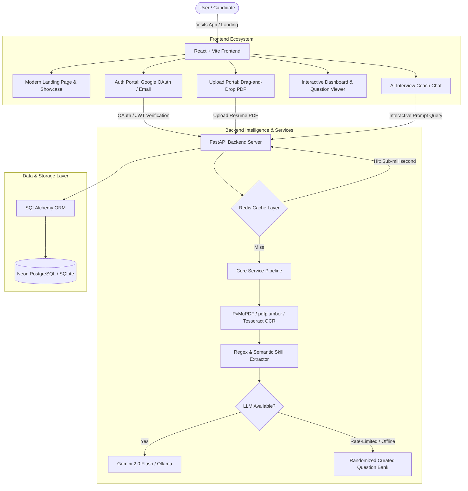

# 🚀 AI-Powered Interview Assistant

## 📋 Comprehensive Project Documentation: Definition, Objectives, Purpose & Enhancements

---

## 1. 📖 Project Definition

The **AI-Powered Interview Assistant** is an intelligent, full-stack career technology platform designed to transform how software engineering and technical job candidates prepare for job interviews.

By bridging modern artificial intelligence with document parsing and web architecture, the platform automatically analyzes a candidate's uploaded resume (PDF format), extracts technical competencies and professional experiences using a hybrid OCR/text extraction pipeline, and generates tailored, high-signal technical interview questions. Additionally, the platform provides an interactive, real-time AI Interview Coach chat interface that allows candidates to simulate technical conversations, receive instant conceptual explanations, and refine their interview responses.

### Core Technology Stack
- **Frontend Architecture:** [React 18](file:///d:/All/Projects/ai-interview-assistant-main/frontend/package.json), [TypeScript](file:///d:/All/Projects/ai-interview-assistant-main/frontend/tsconfig.json), [Vite](file:///d:/All/Projects/ai-interview-assistant-main/frontend/vite.config.ts), [Tailwind CSS](file:///d:/All/Projects/ai-interview-assistant-main/frontend/tailwind.config.js), [Framer Motion](file:///d:/All/Projects/ai-interview-assistant-main/frontend/package.json), [Lucide React](file:///d:/All/Projects/ai-interview-assistant-main/frontend/package.json).
- **Backend Architecture:** [FastAPI](file:///d:/All/Projects/ai-interview-assistant-main/app/main.py) (Python 3.10+), [Pydantic](file:///d:/All/Projects/ai-interview-assistant-main/app/models/schemas.py), [Uvicorn](file:///d:/All/Projects/ai-interview-assistant-main/requirements.txt).
- **Database & ORM:** [SQLAlchemy](file:///d:/All/Projects/ai-interview-assistant-main/app/db/session.py) with dual support for Cloud [Neon PostgreSQL](file:///d:/All/Projects/ai-interview-assistant-main/app/db/session.py#L17-L25) and local [SQLite](file:///d:/All/Projects/ai-interview-assistant-main/app/db/session.py#L12-L16).
- **Caching Layer:** [Redis](file:///d:/All/Projects/ai-interview-assistant-main/app/main.py#L21-L26) with [FastAPI-Cache2](file:///d:/All/Projects/ai-interview-assistant-main/app/main.py#L4-L6) for high-speed sub-millisecond response caching.
- **Document Processing:** [PyMuPDF (fitz)](file:///d:/All/Projects/ai-interview-assistant-main/app/api/v1/endpoints/resume.py#L4), [pdfplumber](file:///d:/All/Projects/ai-interview-assistant-main/requirements.txt), [Pytesseract OCR](file:///d:/All/Projects/ai-interview-assistant-main/requirements.txt).
- **Artificial Intelligence:** [Google Gemini 2.0 Flash API](file:///d:/All/Projects/ai-interview-assistant-main/app/services/llm_provider.py) & [Local Ollama (Llama 3)](file:///d:/All/Projects/ai-interview-assistant-main/app/services/llm_provider.py).
- **Authentication:** Google OAuth 2.0 ([@react-oauth/google](file:///d:/All/Projects/ai-interview-assistant-main/frontend/package.json) & [google-auth](file:///d:/All/Projects/ai-interview-assistant-main/app/api/v1/endpoints/auth.py#L7-L8)) + Custom Credential Authentication.

---

## 2. 🎯 Project Objectives

The primary objectives of the AI-Powered Interview Assistant are:

1. **Automate Resume-to-Interview Customization:** Eliminate generic question banks by parsing candidates' actual resumes and generating questions directly relevant to their declared technology stacks, frameworks, tools, and seniority levels.
2. **Deliver Real-Time Interview Simulation:** Provide an interactive, responsive conversational interface where candidates can rehearse answers, unpack complex concepts, and receive immediate coaching.
3. **Democratize Technical Interview Readiness:** Lower the barrier to high-quality interview preparation for students and professionals across regions through inclusive features, vernacular/humanized response modeling, and multilingual capabilities.
4. **Ensure High Availability & Fault Tolerance:** Build an enterprise-ready architecture that remains functional even under AI service rate limits or temporary cloud network disruptions via intelligent fallbacks and multi-tier caching.
5. **Provide a Frictionless User Experience:** Offer single-click onboarding (Google OAuth), responsive glassmorphic UI design, intuitive drag-and-drop resume uploading, and self-service account recovery.

---

## 3. 💡 Project Purpose

### The Problem
Traditional technical interview preparation suffers from significant shortcomings:
- **One-Size-Fits-All Question Lists:** Most platforms present static lists of questions (e.g., standard LeetCode or generic trivia) that fail to reflect what an interviewer will ask based on a candidate's actual resume and project claims.
- **Overly Robotic / Academic Answers:** Typical AI bots generate overly verbose, unnatural, textbook-style answers that sound scripted and fail to impress human hiring managers.
- **Language & Cultural Barriers:** Non-native English speakers or engineers from diverse linguistic backgrounds often struggle to bridge the gap between their technical depth and conversational interview delivery.
- **High Failure Rates of Cloud AI Tools:** Many modern AI wrappers crash or leave users stranded whenever third-party LLM APIs (like Gemini or OpenAI) hit rate limits or downtime.

### The Purpose & Solution
The purpose of this project is to build an **end-to-end, resilient interview preparation platform** that:
- Accurately inspects candidate resumes (including scanned documents via hybrid OCR).
- Produces realistic technical challenges targeted specifically at their demonstrated stack.
- Teaches candidates how to articulate answers naturally (using realistic frameworks like STAR rather than memorized scripts).
- Keeps candidate preparation uninterrupted through intelligent caching, curated fallback databases, and cloud-native persistence.

---

## 4. 🌟 New Features & Enhancements Added to the Project

The project underwent substantial evolutionary upgrades spanning user interface, authentication, caching, resilience, database architecture, and AI modeling:

### 1. 🔐 Google OAuth 2.0 Integration
- **Implementation:** Integrated Google Identity Services using [`@react-oauth/google`](file:///d:/All/Projects/ai-interview-assistant-main/frontend/package.json) on the frontend and [`google.oauth2.id_token`](file:///d:/All/Projects/ai-interview-assistant-main/app/api/v1/endpoints/auth.py#L7) on the FastAPI backend.
- **Features:**
  - One-click seamless authentication on both [Login](file:///d:/All/Projects/ai-interview-assistant-main/frontend/src/pages/login.tsx) and [Register](file:///d:/All/Projects/ai-interview-assistant-main/frontend/src/pages/Register.tsx) pages.
  - Server-side cryptographic verification of Google JWT tokens against authorized client IDs.
  - Automatic account provisioning in the database with Google ID, user email, and full name.

### 2. 👁️ Password Visibility Toggles & Enhanced Auth UX
- **Implementation:** Added interactive state toggles with Lucide `Eye` and `EyeOff` icons across [Login](file:///d:/All/Projects/ai-interview-assistant-main/frontend/src/pages/login.tsx), [Register](file:///d:/All/Projects/ai-interview-assistant-main/frontend/src/pages/Register.tsx), and [ForgotPassword](file:///d:/All/Projects/ai-interview-assistant-main/frontend/src/pages/ForgotPassword.tsx).
- **Features:** Candidates can inspect password inputs during typing, reducing typos and registration errors.

### 3. 🔄 Self-Service "Forgot Password" Recovery Flow
- **Implementation:** Created a dedicated multi-stage recovery system in [ForgotPassword.tsx](file:///d:/All/Projects/ai-interview-assistant-main/frontend/src/pages/ForgotPassword.tsx) backed by the `/auth/forgot-password` endpoint in [auth.py](file:///d:/All/Projects/ai-interview-assistant-main/app/api/v1/endpoints/auth.py#L113-L135).
- **Features:**
  - Stage 1: Email verification.
  - Stage 2: Password reset with confirmation matching and validation.
  - Stage 3: Animated success confirmation with auto-redirect to sign-in.

### 4. ⚡ High-Performance Redis Caching System
- **Implementation:** Integrated [Redis](file:///d:/All/Projects/ai-interview-assistant-main/Redis) with [FastAPI-Cache2](file:///d:/All/Projects/ai-interview-assistant-main/app/main.py#L4-L6) using asynchronous `aioredis` connections.
- **Features:**
  - **Resume Caching:** Cached `/resume/{resume_id}` endpoints with 300s expiration in [resume.py](file:///d:/All/Projects/ai-interview-assistant-main/app/api/v1/endpoints/resume.py#L412-L414), eliminating repetitive database lookups when navigating between dashboard tabs.
  - **Chat Cache with Custom Hash Builder:** Implemented `chat_key_builder` in [ai.py](file:///d:/All/Projects/ai-interview-assistant-main/app/api/v1/endpoints/ai.py#L9-L15) using MD5 hashed query strings with a 3600s TTL. Identical interview queries return instantly from memory without burning API tokens.

### 5. 🛡️ Robust Offline Fallback Question Engine
- **Implementation:** Developed an extensive, curated domain-specific question bank in [resume.py](file:///d:/All/Projects/ai-interview-assistant-main/app/api/v1/endpoints/resume.py#L21-L312) supporting over 15 major engineering stacks:
  - Frontend: *React, Next.js, JavaScript, TypeScript, HTML/CSS*
  - Backend: *Node.js, Express, Python, FastAPI, Django, Flask, Java, Spring Boot*
  - Databases: *PostgreSQL, MongoDB, SQL, SQLite*
  - DevOps & Cloud: *Docker, AWS, Git, System Design*
- **Features:** If the Gemini API or network reaches quotas or fails, the system parses the resume's detected skills and automatically samples randomized, highly relevant questions matching the candidate's exact profile.

### 6. 🤖 Offline STAR Coaching Mode
- **Implementation:** Enhanced `/ai/chat` error handler in [ai.py](file:///d:/All/Projects/ai-interview-assistant-main/app/api/v1/endpoints/ai.py#L24-L31).
- **Features:** When external LLM connectivity is unavailable, the AI Interview Coach gracefully degrades to an offline coaching mode that guides the user through the **STAR Method** (Situation, Task, Action, Result) for behavioral and system design answers.

### 7. 🗄️ Database Architecture Migration: Prisma to SQLAlchemy & Cloud Neon PostgreSQL
- **Implementation:** Migrated data layer from Prisma Python to [SQLAlchemy](file:///d:/All/Projects/ai-interview-assistant-main/app/db/session.py) with dynamic URL parsing in [session.py](file:///d:/All/Projects/ai-interview-assistant-main/app/db/session.py).
- **Features:**
  - Production-ready connection pooling (`pool_size=5`, `max_overflow=10`, `pool_recycle=300`, `pool_pre_ping=True`) for [Neon Serverless PostgreSQL](file:///d:/All/Projects/ai-interview-assistant-main/app/db/session.py#L19-L25).
  - Retained transparent zero-configuration local SQLite compatibility for local offline development.

### 8. 🎨 Modern Glassmorphic Landing Page & Feature Showcase
- **Implementation:** Built a complete marketing and feature ecosystem located in [frontend/src/components/landing](file:///d:/All/Projects/ai-interview-assistant-main/frontend/src/components/landing) and served on `/` via [LandingPage.tsx](file:///d:/All/Projects/ai-interview-assistant-main/frontend/src/pages/LandingPage.tsx):
  - **[AnnouncementBar.tsx](file:///d:/All/Projects/ai-interview-assistant-main/frontend/src/components/landing/AnnouncementBar.tsx):** Dynamic banner highlighting new features.
  - **[Hero.tsx](file:///d:/All/Projects/ai-interview-assistant-main/frontend/src/components/landing/Hero.tsx):** Dark-mode glassmorphic hero with animated badges, ratings, and instant CTAs.
  - **[MultilingualSection.tsx](file:///d:/All/Projects/ai-interview-assistant-main/frontend/src/components/landing/MultilingualSection.tsx):** Continuous carousel showcasing transcription and interview preparation across 52+ languages (Hindi, Spanish, Japanese, French, German, Telugu, Tamil, Marathi, etc.).
  - **[DesiMode.tsx](file:///d:/All/Projects/ai-interview-assistant-main/frontend/src/components/landing/DesiMode.tsx):** Interactive comparison component comparing stiff, academic "Normal AI" answers with conversational, relatable "Humanized / Desi Mode" answers across behavioral and technical scenarios.
  - **[ResumeBuilder.tsx](file:///d:/All/Projects/ai-interview-assistant-main/frontend/src/components/landing/ResumeBuilder.tsx):** Interactive display showcasing 10 ATS-friendly resume templates and a 6-step AI rewrite workflow.
  - **[Comparison.tsx](file:///d:/All/Projects/ai-interview-assistant-main/frontend/src/components/landing/Comparison.tsx):** Feature matrix comparing the platform against conventional interview prep methods.
  - **[Testimonials.tsx](file:///d:/All/Projects/ai-interview-assistant-main/frontend/src/components/landing/Testimonials.tsx) & [TrustLogos.tsx](file:///d:/All/Projects/ai-interview-assistant-main/frontend/src/components/landing/TrustLogos.tsx):** Social proof and hiring partner badges.

### 9. 📊 AI Generation Randomness & Consistency Testing Suite
- **Implementation:** Created [test_randomness.py](file:///d:/All/Projects/ai-interview-assistant-main/test_randomness.py).
- **Features:**
  - Dynamically synthesizes a realistic PDF resume on the fly using PyMuPDF.
  - Executes parallel runs against the Gemini LLM engine.
  - Calculates set intersection, direct string overlap, and diversity metrics to guarantee questions are varied and non-repetitive across candidate sessions.

### 10. 🚀 Deployment & Build Streamlining
- **Implementation:**
  - Configured [frontend/vercel.json](file:///d:/All/Projects/ai-interview-assistant-main/frontend/vercel.json) with client-side SPA routing rewrites.
  - Cleaned and optimized [requirements.txt](file:///d:/All/Projects/ai-interview-assistant-main/requirements.txt) for cloud platforms (Render / Railway), resolving OS-specific dependency conflicts (such as pywin32).

---

## 5. 🏗️ System Architecture & Workflow

---

## 6. 📌 Summary Table of Project Evolution

| Dimension | Baseline State | Enhanced State |
| :--- | :--- | :--- |
| **Authentication** | Basic credentials only | Google OAuth 2.0 + Password Visibility Toggles + Self-service Forgot Password workflow |
| **Database** | Prisma Python SQLite | SQLAlchemy ORM with Neon Serverless PostgreSQL connection pooling & SQLite fallback |
| **Caching** | No caching (repeated queries hit DB & LLM) | Redis + FastAPI-Cache2 with MD5 key hashing and 3600s TTL |
| **AI Reliability** | Crashed or failed on API limits | Curated 15+ stack fallback bank + Offline STAR coaching mode |
| **Landing & Showcase** | Basic bare redirect | Rich glassmorphic landing page featuring Desi Mode, Multilingual support, Resume Builder, and Testimonials |
| **Testing & QA** | Manual smoke testing | Automated PDF generation & question randomness statistical test suite (`test_randomness.py`) |
| **Deployment** | Local only | Vercel SPA configuration + Render cloud deployment-ready backend |
